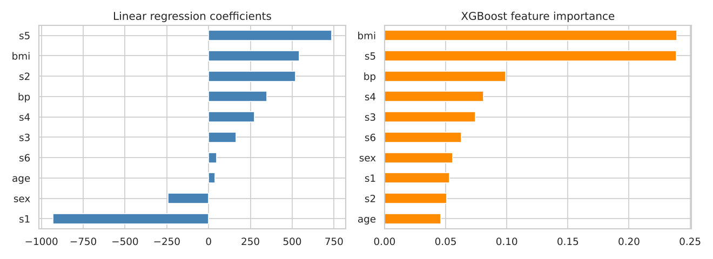
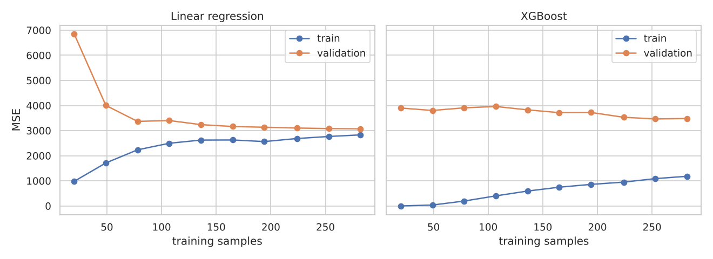

# Predicting Diabetes Disease Progression

Predicts how much a patient's diabetes progresses over one year from ten baseline measurements (age, sex, BMI, blood pressure and six blood serum values), comparing linear regression with XGBoost.



## Data

The scikit-learn diabetes dataset: 442 patients, 10 standardized features, and a continuous progression score as the target. It loads with `sklearn.datasets.load_diabetes`, so no download is needed.

## Method

1. Linear regression on each feature alone (5-fold cross-validation on the training set)
2. All 45 feature pairs
3. Linear regression and XGBoost on all ten features, scored on a held-out 20% test set
4. Learning curves from 20 to 280 training samples to see where each model overfits

## Results

| Model | Features | CV MSE | Test MSE | Test R² |
|---|---|---:|---:|---:|
| Linear regression | BMI only | 3,909 | | |
| Linear regression | BMI + S5 | 3,359 | | |
| Linear regression | all 10 | 3,074 | 2,900 | 0.45 |
| XGBoost | all 10 | 3,490 | 2,940 | 0.45 |

- BMI is the strongest single predictor. Adding S5 (a serum triglyceride measure) cuts the error by 14%, the biggest gain of any pair.
- On held-out data the two models score about the same. Linear regression is easier to explain, so it is the better choice for this problem.
- XGBoost reaches near-zero error on its training data at every sample size, but this does not carry over to validation data. An earlier version of this project reported that training error as the result. This version reports held-out scores only.



## Files

| File | Contents |
|---|---|
| `diabetes_progression.ipynb` | Full analysis, runs top to bottom |
| `images/` | Charts exported from the notebook |
| `Data_Science.pptx` | Class presentation of the project |

## How to run

```bash
git clone https://github.com/mehtesham13/Machine-Learning-Project.git
cd Machine-Learning-Project
pip install -r requirements.txt
jupyter notebook diabetes_progression.ipynb
```

Author: Muhammad Ehtesham · [LinkedIn](https://www.linkedin.com/in/muhammad-ehtesham-dsa)
